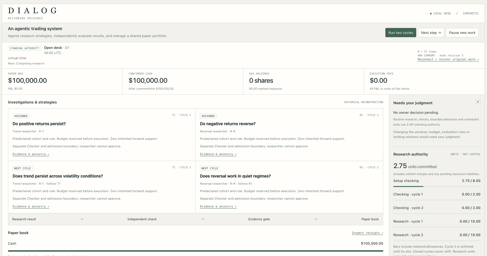

# Dialog

Dialog is a trading research and paper-trading workspace. Competing research approaches develop hypotheses, an independent evaluator checks their results, and eligible strategies share a portfolio.

- Retain experiments, rejected ideas, and the evidence behind each decision.
- Use prior findings to choose the next investigation.
- Allocate shared exposure and account for orders, partial fills, cash, and fees.
- Recover interrupted work without duplicating charges or trades.
- View research, strategies, positions, spending, and exceptions in one workspace.

Built with Python, LangGraph, and [Adaptive Research Harness](https://github.com/reckoning-machines/adaptive-research-harness). The current version uses synthetic data and paper execution.

[Development guide](APP.md) · [Architecture and contracts](docs/contracts.md) · [Validation](validation/app/REPORT.md)
