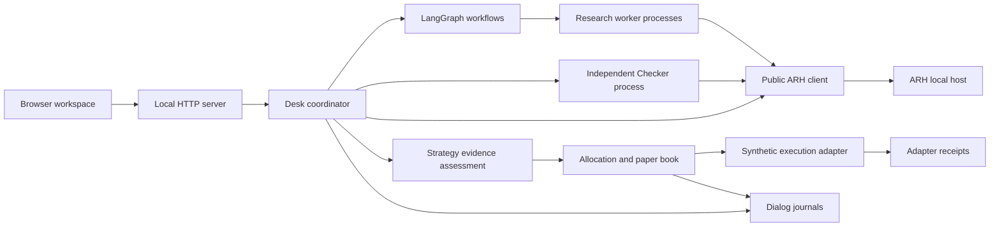

# Dialog architecture

Dialog is an agentic trading system implemented as a local Python application. Its current version runs two predefined research cycles with deterministic research workers, independent checking, and a shared synthetic paper portfolio. It has working execution and recovery paths; open-ended LLM research and live trading are not implemented.

This document describes the code inspected at `a6a4f11a7dae090a03fd865008eeadfdf7202ca9`, on 2026-11-03. [Development guide](APP.md) covers installation and operation. [Behavioral contracts](docs/contracts.md) retain the fuller design requirements; they should not be read as a claim that every proposed capability is implemented.

## Components

| Component | Implementation | Responsibility |
| --- | --- | --- |
| Browser and local API | [workspace.html](src/dialog/workspace.html), [__main__.py](src/dialog/__main__.py) | Render current projections, inspect evidence, submit bounded actions |
| Desk and workflow orchestration | [desk.py](src/dialog/desk.py) | Advance the finite schedule, coordinate research, evaluate strategies, recover interrupted steps |
| ARH integration | [governance.py](src/dialog/governance.py) | Start/reopen the managed host, call public interfaces, retain request outcomes and authoritative references |
| Research and checking | [worker.py](src/dialog/worker.py), [evaluator.py](src/dialog/spec/evaluator.py) | Run calculations and independent checks under their respective identities and grants |
| Strategy admission | [evidence.py](src/dialog/evidence.py) | Assess the application’s evidence requirements beyond arithmetic correctness |
| Portfolio and execution | [book.py](src/dialog/book.py), [execution.py](src/dialog/execution.py) | Allocate shared exposure, record orders/fills, account for cash and fees, enforce exits |
| Persistence and fixtures | [store.py](src/dialog/store.py), [fixtures.py](src/dialog/fixtures.py) | Persist domain facts and command state; define the fixed synthetic mandate, cohorts and questions |

The browser uses HTML, CSS and JavaScript without a frontend framework. Python’s `ThreadingHTTPServer` serves it on loopback. A process lock permits one coordinator per desk directory, and the application serializes desk actions. LangGraph coordinates execution; it does not grant authority.

## Ownership and authority

ARH owns research grants and budget accounting, evidence records, independent Checks, policy decisions and applied governance transitions. Dialog consumes those through the public client. It does not import ARH internals or inspect its ledgers directly.

Dialog owns strategy dossiers and admission, shared allocation, paper orders, accepted fill records, portfolio accounts, monitoring and retirement. An ARH Check passing does not itself admit a trading strategy. Dialog verifies the evidence dossier and records a separate application decision with references to the ARH Check and applied transition.

The execution adapter owns synthetic order acknowledgements, fills and cancellation receipts. Dialog validates those receipts before booking them. The adapter does not decide strategy eligibility or allocation.

Researchers use separate role credentials and cannot check or approve proposals. Independent arithmetic checking runs in a Checker subprocess; the additional strategy-evidence assessment is ordinary code in the coordinator. The trusted coordinator also holds a broad Principal credential for bootstrap and supported policy/host operations. Credentials are separated by process and file, not by operating-system identity. This is a cooperative local trust boundary, not narrowly scoped Principal enforcement.

## Research and portfolio cycle

1. Bootstrap the fixed mandate, research identities, Checker identities, grants and two Themes through public ARH operations.
2. Record each experiment’s input cohort, partition and evaluation rule. The two researchers reserve from the cycle’s shared Research grant before attempting work.
3. Execute deterministic calculations and persist tool receipts. Commit results and settle charges through ARH. Researchers retain access to both approaches’ evidence.
4. Independently check each proposed hypothesis registration, then use ARH’s supported policy decision and Apply interfaces. Follow-ups stay within the original Themes.
5. Assess strategy admission separately: exact inputs, predeclared partition, information availability, independent arithmetic, positive base/stress results, bounded drawdown and absence of prior partition exposure. Rejected work remains recorded.
6. Allocate eligible strategies together, submit paper orders, reconcile partial fills and fees, and update cash and positions.
7. Retain shared research results and portfolio feedback in selection records for the next predefined investigation. Research expiry and holding deadlines are separate.

The questions and cohort selection are fixed fixtures. The second cycle records why prior evidence motivates its questions; the application does not yet generate arbitrary investigations or optimize research methods autonomously. Both research workers are deterministic Python processes, not LLM agents.

The paper adapter uses a fixed $100 price, whole shares and a $0.10-per-share fee. The allocation rules constrain strategy weight, aggregate underlying exposure, gross exposure, cash and ordinary turnover. A new allocation batch requires a flat, reconciled starting book. Several strategies can receive positions in that batch; general rebalancing over an existing portfolio is not implemented.

Required exits retain a separate cost allowance, cancel/reconcile opening orders before sizing sales, and cannot oversell. Retirement completes only when the strategy is flat and no executable order remains. Five-minute monitoring slots and holding deadlines use virtual historical time. There is no continuous wall-clock scheduler or live price feed.

## Persistence and recovery

Runtime state defaults to `.local/dialog` and is excluded from Git.

| Store | Contents and standing |
| --- | --- |
| `desk.sqlite` | Dialog’s append-only domain facts, UI command records, persisted control state and projections; cash/positions derive from its opening capital and accepted fills |
| `governance-journal.sqlite` | Consumer request keys/payloads/outcomes, result references and cached public ARH exports; it does not replace ARH authority |
| `adapter.sqlite` | Synthetic order, fill, cancellation and mark receipts |
| `desk-checkpoints.sqlite`, `research-checkpoints.sqlite` | LangGraph workflow checkpoints; these confer no authority |
| Receipt directories | Durable execution receipts used to recover original attempts |
| `arh/` and `setup/` | Local host state, private connection files and the exact run profile; the application accesses governance state through public interfaces |

Dialog persists stable command keys before public calls and checks the original request outcome after uncertainty. Domain facts use unique keys and content hashes so replay cannot silently replace an earlier fact. SQLite transactions use WAL and full synchronization; there is no atomic transaction spanning Dialog, ARH and the adapter.

Recovery resolves each boundary separately:

- A lost paper-order response is resolved by querying its original order ID. Existing fill IDs are not booked again.
- A research attempt with a durable receipt reuses that receipt. An uncertain attempt without a receipt remains charged at its maximum.
- Replacement work requires termination/quiescence evidence and sufficient remaining authority. The demonstration permits one bounded replacement.
- An interrupted allocation resumes creation of its original strategy/order records. An interrupted exit preserves its original obligation and cost allowance.
- A fresh coordinator reopens the persisted stores and checks current authoritative preconditions before continuing. It does not recover deleted journals or treat a graph checkpoint as permission.

Research accounting uses simulated units and remains separate from paper dollars. Each research cycle has a 10.00 Research grant shared by the two researchers and a separate 2.00 Checker grant. Startup checking has an 8.00 cap; Research lineage ceilings remain 10.00. A complete demonstration settles 8.75 units and retains 1.00 in hypothesis-funding allowances.

## Interface

`GET /` serves the workspace. `GET /api/state` returns portfolio/research projections and their observed ARH closure and time. `GET /api/evidence` exposes domain records and the cached public ARH export. These reads do not claim an atomic cross-system snapshot.

`POST /api/action` accepts only run, next step, scheduled exits, recovery, and pause/resume actions. Requests carry a UUID command key, expected desk revision and a local request header; supplied origins are restricted to the loopback workspace. Stale requests, conflicting commands and concurrent dispatch refuse. These controls are for a trusted local application, not multi-user authentication.

The workspace distinguishes busy, interrupted, stale, unavailable and refused states. It displays research spending separately from portfolio capital, and exposes record references through inspection. Its layout draws on IRIS, but there is no runtime IRIS integration.

## Dependencies and validation

[Automatic setup](scripts/setup_local.py) installs locked Python dependencies and the pinned ARH checkout under `.local/dependencies/arh`. The [client installer](scripts/install_arh_client.py) builds from clean public source and verifies module hashes. Startup refuses a different ARH commit, tracked source modifications or mismatched client bytes. Exact versions and the ARH commit are in [arh-dependency.json](arh-dependency.json) and [requirements.lock](requirements.lock).

The [application validation](validation/app/REPORT.md) records ten portfolio/evidence tests and a full continuity test with four coordinator kills and core-host reopening. The separate [ARH consumer gate](validation/v01_integrated_m1/REPORT.md) records all 14 required interface/recovery witnesses. These are bounded results for the retained source revisions, not claims of profitability or production readiness.

The current system has no paid provider, live market-data adapter, broker connection, real capital, open-ended research planner, general backtesting engine or production deployment. The synthetic execution protocol is replaceable; choosing a commodity engine and implementing its adapter remain future work.
