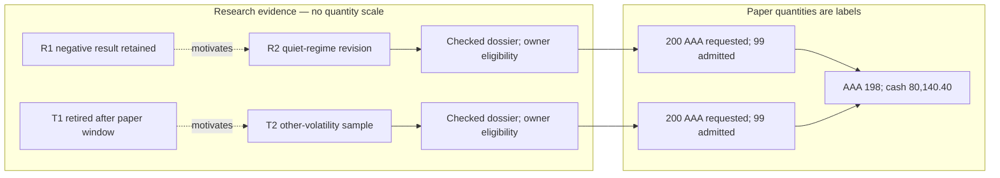

# W-2 — operate the Murmur desk for two cycles

**Frozen-baseline routing:** [B-01](baseline-review.md) supplies the final narrow Theme comparison. This replay retains its original formal-Theme choices; those choices do not prove that ordinary follow-ups require new Themes. Existing records/accounts remain fixture evidence, not the mandatory implementation path.

Retained manual-owner baseline. The later [W-3 owner-away replay](away-replay.md) challenges its approval load under proposed DA-1; its records and totals do not rewrite this baseline.

**Paper operation only.** The [contracts](contracts.md) determine the replay; failures and repairs are recorded in [CL-03](review.md). All owner choices below are **hypothetical rehearsal choices**, not actual acceptance, grants or runtime authorization. No ARH, graph, simulation engine or application was run.

Read the workspace cards as the product experience; the adjacent records are inspection detail. All data is **synthetic Historical Reconstruction**, never forward evidence. E/T identifiers are symbolic immutable fixture records, not invented actual ARH sequences/hashes. Runtime would require exact run/ledger/sequence/hash references through public interfaces. Here exact content means the textual records and arithmetic printed below. A panel is current only at its named paper snapshot.

## Fixed inputs and opening records

W2-M: AAA/BBB long-only, cash$100,000, gross40%, underlying25%, strategy20%, cash floor60%, ordinary daily turnover20%, whole-share lots. Two slots D1/D2 at18:00 UTC; ordinary turnover resets by day, never by restart. AAA prices/marks remain$100. Buy price ceiling and exit price floor100; simulated fee$0.10/share each side; no slippage, interest, dividends, deposits or other cash event. Required exits use C-05. A cash cost envelope is rounded down to cents.

R-T researches trend, R-R reversal, CK independently checks, O decides. Scheduler/intake/allocator/executor act only under the proposed mandate. Operator may reconcile outcomes and obtain host quiescence, not waive authority. No providers or IRIS.

E-* denotes ARH evidence; T-* its proposal/check/decision/apply records. M-* denotes Murmur mandate/method/dossier/lifecycle/exit; O-* orders; F-* accepted fills. Listed pairs are distinct records, not a cross-system atomic transaction. Each hypothetical proposal follows: check exact current base → owner decision → ARH Apply → next proposal's check at its new base. Unsupported runtime choreography remains a finding.

B0 assumes an already initialized hypothetical desk: M-OPEN cash100,000; M-MANDATE enumerates both slots; T-SETUP carries checked controls. Historical setup grant G-SETUP cap1.00 settled0.50, pending0, closed unused0.50. Setup is visible, not free. G-R1/G-R2 each10.00, G-C1/G-C2 each2.00; both cycles already admitted/applied upstream, with cycle2 withheld from Murmur dispatch until its slot and prior closure. ARH may report that future grant spendable; the local schedule does not change its budget. Research lineage ceiling10.00 spans both cycles; W2-M Checker lineage ceiling4.50 spans setup and both cycles without enlarging grant pools. These fixture settings are not proof of supported external startup.

Metering: every research reservation2.00, attempt maximum1.00. Cycle1 actual T0.75/R1.00. Cycle2 T0.75/R-original UNKNOWN1.00/R-replacement0.50. Each calculation/registration check costs0.50; each successor-Theme check0.25. Checker reservation/maximum equals actual. Record viewing, recovery and deterministic portfolio mechanics are unmetered in this fixture; no hidden research attempt or provider bill.

## W2-01 — open the desk

> **Murmuration · D1 18:00 · Historical Reconstruction · Ready to start**
>
> **10.00 shared research units available; 2.00 separate checking units.** Future cycle12.00 committed in the fixture, not available today. Prior setup spent0.50.
>
> Trend assignment: continuation. Reversal assignment: recovery after a fall. Shared history visible to both.
>
> **Cash$100,000; holdings none; orders none.**
>
> **Needs you:** confirm the Murmur two-slot mandate/delegates against the already-applied ARH grants. No new upstream grant is created here; no dispatch until both owners permit it.
>
> Sources: M-MANDATE/M-OPEN, T-SETUP/E-BUDGET-OPEN; P0.

Hypothetical OD-01 creates M-DEC-OPEN. E-GRANTS-OPEN is a fresh public read of the already-applied upstream grants, not another grant/change or uncharged check. CY-W2-1 fixes slot, closure, grants and operation keys. Duplicate trigger returns that cycle. Forecast research1.75 +checks1.00 +next-Theme checks0.50; the forecast does not authorize spending.

**Behavior:** C-01 now explicitly enumerates both budgets; the former cycle-reset ambiguity is F-17. **Continuity:** exact mandate, grants and cycle recover dispatch eligibility; absence stops. **Clarity:** owner sees available funds separately from future commitment. OD-01 is required; ordinary runs then need no separate approval.

## W2-02 — competing research and shared learning

E-DATA1/E-SPLIT1 declare DEV1 and validation cohorts V1T/V1R before work. Each cohort has three fixed$1,000 closed toy trades. Feature availability upper bound09:00, simulated decision09:05, entry10:00, outcome16:00 on the historical event day. Trade IDs, point-in-time universe, unadjusted revision r1 and calendar are fixed. Outcomes cannot enter the simulated decision closure early. All event days precede D1 analysis.

| Fixed cohort/rule | Gross outcomes | Base/stress cost per trade | Base equity path | Gross /base net /stress net | Base drawdown |
|---|---|---|---|---|---|
| V1T, preceding positive return | 40,10,50 | 10/20 | 1,030;1,030;1,070 | 100/70/40 | 0% |
| V1R, preceding negative return | −20,10,−10 | 10/20 | 970;970;950 | −20/−50/−80 | 5% |

This is a declared adapter-output fixture: enough to check arithmetic and desk behavior, not proof of backtester execution from raw prices. Selected events/timing are stipulated textual inputs. Research cost10/20 per trade differs from desk execution fee0.10/share.

E-DES-T1/R1 freeze rules, expectations, standard and splits. E-RES-T1/R1 reserve2 each; E-ATT-T1/R1 admit maxima1 and distinct claims. E-RESULT-T1/R1 retain the table; E-SET-T1=0.75, E-SET-R1=1.00. E-CLOSE-T1 releases1.25, E-CLOSE-R1 releases1.00. Neither result grants eligibility.

> **D1 · Two results await checking**
>
> Trend: **+$70 base net; +$40 stressed. Promising, unchecked.**
>
> Reversal: **−$50 base net; −$80 stressed. Failure retained, unchecked.**
>
> Research spent1.75, pending0, available8.25; Checker available2.00. Cash$100,000.
>
> **Needs you:none. Independent checking proceeds under standing authority.**
>
> Sources: E-RESULT/SET/CLOSE-T1/R1; P0.

E-LEARN-T1 cites reversal losses and asks whether trend depends on volatility; failures do not prove trend. E-LEARN-R1 cites trend costs/sensitivity and its own losses, proposes quiet-regime reversal. Both retain both result references; neither checks the other. V1T/V1R become explored desk-wide.

**Behavior:** arithmetic decides outcomes; learning records motivation only. **Continuity:** exact designs/results/charges preserve failure and success. **Clarity:** favorable number is not an approval. No owner intervention.

## W2-03 — evaluate evidence, then admit

CK uses0.50 per current registration check: T-CK-T1/R1 both correctness PASS. Reversal is correctly calculated and economically unsuccessful. Hypothesis registration is a question, not demonstrated belief.

First pass: M-DOS-T1a cannot retrieve the precommitted partition reference. Eligibility refuses despite PASS. This is a safe refusal but an incomplete workflow if the screen offers only “retry” or “approve anyway” (F-18).

> **D1 · Calculation checked; evidence incomplete**
>
> Trend: arithmetic correct; **admission blocked—original split unavailable**.
>
> Reversal: arithmetic correct; **admission fails—net−$50 and5% drawdown**.
>
> Next action: intake operator retrieves the exact original split. You cannot waive it.
>
> **Needs you:none yet. Orders prohibited.** Research spent1.75; Checker1.00.
>
> Sources: T-CK-T1/R1, M-DOS-T1a/R1; P0.

Replay: E-LOOKUP-SPLIT1 retrieves E-SPLIT1 content already referenced by E-DES-T1 before the attempt. M-DOS-T1b replaces only the incomplete dossier. No new split or result is invented. Unrecoverable bytes would leave the case blocked; O would choose fresh research or stop.

> **D1 · Ready for your decisions**
>
> **Register both research questions?** Checked questions, not scientific support.
>
> **Admit SV-T1 for bounded paper use?** Dossier complete; historical toy evidence only. It requests200 AAA; limits may reduce this.
>
> **SV-R1 rejected for paper use.** No criterion-waiver action.
>
> Deferring leaves cash$100,000 and no orders.
>
> Sources: T-CK-T1/R1, E-SPLIT1, M-DOS-T1b/R1; P0.

OD-02: separate T-DEC-H-T1/R1 and T-APPLY-H-T1/R1 preserve both research questions. OD-03: M-ADMIT-T1 grants domain eligibility. M-REJECT-R1 records failed criteria under the mandate; request stays visible but ineligible. The serial check/decide/apply ordering uses current bases; check tariffs do not conceal stale checks and free rechecks.

**Behavior:** provenance repair cannot retroactively change the experiment; PASS≠eligibility. **Continuity:** exact check/decision/apply plus dossier/eligibility reconstruct state; decided≠applied. **Clarity:** research registration and paper eligibility are separate owner decisions. Their repetition is friction U-W2-01, not silently delegated authority.

## W2-04 — allocate; lose an order response

Both proposed strategies requested200 AAA. R1 is ineligible and excluded first; counting it as an active competitor would invent eligibility. Actual eligible overlap comes in cycle2.

F-19 first-pass failure:200 shares cost20,000 plus20fees, leaving NAV99,980 and20.004% strategy exposure, above20%. Replay: conservative denominator100,000−20=99,980; strategy cap19,996/100=199.96 shares. Other limits do not tighten; round once to **199**. Fee≤19.90; cash80,080.10; NAV99,980.10. M-AL1 records requested200/admitted199 and excluded R1; no share is added after rounding.

> **D1 · Order response unknown**
>
> Trend200 requested → **199 admitted**. Reversal200 → **0, ineligible**.
>
> O-B1 buy199: **confirmation missing; do not create a new order**.
>
> Last confirmed holdings0; cash$100,000. Commitments up to$19,919.90; cash after commitments at least$80,080.10.
>
> **Needs you:none. Operator queries O-B1.** Unavailable lookup blocks further exposure.
>
> Sources: M-AL1, durable intent J-B1; book P1, execution status unavailable.

J-B1/O-B1 persisted before send. Adapter accepted and filled80@$100 fee8 (X-B1a), then response was lost before local fill commit. Last-confirmed0 is honest; assuming80/199 is not.

Fresh operator queries O-B1, recovers PARTIAL80/199 and X-B1a. F-B1a commits once at P2: holdings80, cash91,992, NAV99,992. Remaining119 commitment11,911.90 leaves cash after commitments80,080.10. F-B1b fills119 fee11.90 at P3:199 shares, cash80,080.10, NAV99,980.10. Repeated X-B1a changes nothing. No second order/owner approval.

> **D1 · Portfolio confirmed**
>
> **AAA199 ($19,900); cash$80,080.10; NAV$99,980.10.**
>
> Fills80+119; fees19.90; outstanding0; ordinary turnover19.90%.
>
> Changed: response recovered, no duplicate. **Needs you:none.**
>
> Sources: M-AL1/O-B1/F-B1a,b; P3.

**Behavior:** fees and original order lookup determine outcome. **Continuity:** intent, order ID and receipts recover exactly80 then199. **Clarity:** confirmed cash≠cash after commitments (F-21). Missing durable lookup would safely refuse but leave the workflow incomplete (U-W2-02).

## W2-05 — required exit and cycle1 close

OD-04 M-RETIRE-T1 closes the planned paper observation window, not the scientific question. E-X1 target flat199, pre-exit NAV99,980.10. No pending buys. O authorizes retirement; executor handles bounded partial exits.

Envelope99,980.10×0.0025=249.95025, conservatively rounded **down to249.95**. Reserve fee19.90; envelope headroom230.05. Cash80,080.10 prefunds it. Ordinary turnover19,900 leaves only100; exit19,900 uses the exit exception, never replenished ordinary allowance.

> **D1 · Retirement executing**
>
> **Retiring;199 AAA remain.** Cost envelope249.95; expected fee19.90.
>
> Ordinary turnover19.90% +exit19.90%=39.80%. **Exception only closes this named position.**
>
> **Needs you:none.** Missing price or costs above envelope pause exit for resolution.
>
> Sources: M-RETIRE-T1/E-X1/O-S1; P4.

F-S1a sells79 fee7.90 → P5:120 shares, cash87,972.20, NAV99,972.20. Process death. Envelope249.95 still: consumed7.90, reserved12, uncommitted230.05. Fresh executor recovers O-S1 remainder120, not a new199 sell. F-S1b sells120 fee12 → P6 flat cash/NAV99,960.20. Consumed19.90; unused230.05 released. M-RETIRED-T1 at P7 requires no order/fill liability. Day fees39.80; total turnover39.80%; all P&L is costs. Old admission cannot resurrect T1.

E-PORT-FEEDBACK1 cites operational fees/fills, not alpha. E-SEL-T2/R2 cite both research histories; reject “retest V1 for fresh support”; propose volatility-robustness trend and quiet-regime reversal. CK checks each Theme at0.25. OD-05 separately approves T-NEXT-T2/R2 and method successors M-METHOD-T2/R2, with parents and zero inherited forward record, then authorizes Principal FENCE-R1/FENCE-C1 for the completed cycle. Only the upstream Principal may fence; this is an explicit owner action, not a scheduler privilege.

> **D1 · Cycle complete; portfolio flat**
>
> Cash/NAV99,960.20; P&L−39.80, all fees. T1 retired; R1 rejected.
>
> Research1.75/10; Checker1.50/2. **Unused8.75 closes; it cannot enlarge cycle2.**
>
> **Needs you:** approve next questions/methods or stop, and fence the completed cycle grants. Both questions cite shared failures and paper costs.
>
> Rehearsal OD-05 approves; cycle2 still waits for its slot/grants.
>
> Sources: E-SEL/T-NEXT/M-METHOD-T2,R2; M-RETIRED-T1; P7.

**Behavior:** exact exit authority allows excess turnover; next choices use retained evidence. **Continuity:** remainder/envelope/lineage recover after death. **Clarity:** retiring≠flat; retirement≠scientific rejection. OD-04/05 require owner judgment; mechanical recovery does not.

## W2-06 — next cycle; research interrupted

D2 opening NAV99,960.20; ordinary turnover resets by day. Cycle1 grants closed/fenced. E-AUTH-SLOT2 records fresh public reads confirming the already-applied cycle2 grants remain active; M-SLOT2 opens the local scheduled dispatch gate. CY-W2-2 pins OD-05, history and inputs. Inactive upstream grants stop dispatch for owner resolution; no new grant, delayed Apply or ARH activation command is invented.

> **D2 · New cycle, same memory**
>
> Research10.00 available; Checker2.00. Prior cycle spent3.25; setup0.50 retained.
>
> T2: **trend in another volatility sample?** R2: **reversal in a predeclared quiet regime?**
>
> New V2T/V2R sealed before dispatch. V1 permanently explored. Cash99,960.20; holdings none.
>
> **Needs you:none—OD-05 and both-slot authority cover this work.**
>
> Sources: E-SEL-T2/R2, E-SPLIT2, E-AUTH-SLOT2/M-SLOT2/CY-W2-2; P7.

E-SPLIT2 fixes separate three-trade cohorts: quiet flags available09:00, simulated decision09:05, outcomes16:00. Both designs precommit before result release. Shared results make both cohorts explored afterward.

E-RES-T2/R2 each2.00; E-ATT-T2/R2 maxima1, claims consumed. T receipt0.75 is saved durably; R receipt is lost after possible execution. Both workers/coordinator die on paper with checkpoints lagging. R has no inventable conclusion.

| Boundary / exact event | Settled | Pending maxima | Grant usage | Spendable | Released allowance |
|---|---:|---:|---:|---:|---:|
| E-RES-T2/R2 | 0 | 0 | 4 | 6 | 0 |
| E-ATT-T2/R2; death | 0 | 2 | 4 | 6 | 0 |
| Recover T receipt; E-SET-T2=0.75 | 0.75 | 1 | 4 | 6 | 0 |
| E-CLOSE-T2 releases1.25 | 0.75 | 1 | 2.75 | 7.25 | 1.25 |
| E-SET-R2-UNKNOWN=1.00 | 1.75 | 0 | 2.75 | 7.25 | 1.25 |
| Replacement refused, proof missing | 1.75 | 0 | 2.75 | 7.25 | 1.25 |
| Host Q-R2; E-ATT-R2b maximum1 | 1.75 | 1 | 2.75 | 7.25 | 1.25 |
| E-SET-R2b actual0.50 | 2.25 | 0 | 2.75 | 7.25 | 1.25 |
| E-CLOSE-R2 releases0.50 | 2.25 | 0 | 2.25 | 7.75 | 1.75 |

Usage/spendable follow S-15 definitions. Each row is a distinct expected record/response. First refused replacement key remains refused; after Q-R2 a fresh replacement-request key under the same operation and dispatch index1 is legitimate. It does not reuse execution permission. Q-R2 is host proof both old worker generations are gone; tools cannot outlive callers. If proof never arrives, terminate at the refusal row: safe but incomplete, as S-15B requires. Here proof arrives, an explicit new input—not “either outcome passes.”

> **D2 · Research interrupted**
>
> T recovered without rerun. R: **result unknown; charged1.00 at maximum**.
>
> R's unused1.00 still held for replacement. Shared spendable7.25; settled1.75; unsettled monetary maxima0.
>
> **Operator action:** establish old-worker quiescence. Timeout is not rerun permission. **Owner decision:none yet.** Persistent missing proof leaves the cycle blocked; stopping work never erases its charge.
>
> Sources: E-SET/CLOSE-T2, E-SET-R2-UNKNOWN, replacement refusal; P7.

After proof/replacement the card reads: “Both results recorded; three attempts charged2.25 (T0.75, unknown R1.00, replacement0.50); checking next; no owner action.” Original R remains unknown in history.

**Behavior:** exact accounting specifies each outcome. **Continuity:** journals/receipts, public outcomes, proof and replacement identity recover without duplicates. **Clarity:** execution uncertainty differs from unsettled money. Missing host proof is a completion gap U-W2-02 even when refusal behavior is correct.

## W2-07 — new evaluations, new owner decisions

| Exact result/cohort | Gross outcomes | Gross /base net /stress net | Base equity /drawdown | Interpretation |
|---|---|---|---|---|
| E-RESULT-T2/V2T | 25,20,25 | 70/40/10 | 1,015;1,025;1,040 /0% | Toy trend persists in this sample; no inherited support |
| E-RESULT-R2b/V2R | 30,25,25 | 80/50/20 | 1,020;1,035;1,050 /0% | Quiet revision passes toy costs; old failure/unknown attempt remain |

Base10/stress20 cost per trade unchanged. T-CK-T2/R2 each cost0.50 under G-C2 and reproduce exact results/closures. M-DOS-T2/R2 pin immutable designs/splits and old failures. OD-06 registers H-T2/H-R2 through current checks/decisions/applies. OD-07 admits new paper strategies SV-T2/SV-R2, dossiers bound to exact upstream applied refs. T1 stays retired; successor is not silent resumption.

> **D2 · Two paper candidates ready**
>
> T2 net+$40/stress+$10; R2 net+$50/stress+$20. **Both calculations checked; dossiers complete; historical toy evidence only.**
>
> **Needs you:** register each question and admit each new strategy.
>
> **If both admitted:** both want AAA.400 requested shares will be reduced by shared limits and turnover.
>
> Rehearsal OD-06/07 approve. Research2.25; Checker1.00 spent.
>
> Sources: E-RESULT-T2/R2b, T-CK/APPLY-H-T2/R2, M-DOS/ADMIT-T2/R2; P7.

**Behavior:** distinct cohorts/decisions establish eligibility. **Continuity:** predecessor failure/unknown attempt remain exact history. **Clarity:** favorable numbers do not hide concentration. Separate approvals remain product friction U-W2-01.

## W2-08 — overlapping exposure and shared portfolio

Both eligible requests200 AAA@$100. Full-request fee ceiling40; conservative denominator99,960.20−40=**99,920.20**. Each20% cap gives19,984.04=199.8404 shares. Shared AAA25% gives24,980.05=249.8005 combined,124.90025 each. Turnover20% of opening NAV99,960.20 gives19,992.04=199.9204 combined,99.9602 each. Gross/cash do not tighten. Round each down once: **99+99=198**; no redistribution of1.9204 shares of unused combined fractional capacity.

M-AL2 at P8 records every clamp and absolute target. O-B2T/O-B2R each99, persisted before send. Commitments19,800+19.80fees. F-B2T fills99 fee9.90 → P9: cash90,050.30, confirmed99, remaining commitment9,909.90 counted once. F-B2R fills99 fee9.90 → P10:198 shares attributed99 each, cash80,140.40, NAV99,940.40. AggregateAAA19,800 below25%; each9,900 below20%; cash above60%.

First-pass F-20: treating every revision advance as invalidation would refuse O-B2R solely because the first fill moved P8→P9. Replay admits the exact remaining child against current state within original target/cost bounds, counting filled/outstanding quantities once. External incompatible changes invalidate undispatched remainder. Submitted commands are not silently rebased; actual fills cannot be discarded as stale.

> **D2 · Shared portfolio confirmed**
>
> **AAA198 ($19,800), T2=99/R2=99. Cash$80,140.40; NAV$99,940.40.**
>
> Requested200+200 → strategy caps → underlying cap → turnover cap → **99+99**. Rounding residue stays cash.
>
> Today's fees19.80; all-session fees59.60. Paper P&L−59.60, entirely costs at flat prices. **No trading-alpha evidence yet.**
>
> **Needs you:none.** Existing eligibility/mandate cover mechanics.
>
> Sources: M-AL2, O-B2T/R, F-B2T/R; P10.

**Behavior:** fee-aware clamps, rounding and child continuation determine198. **Continuity:** exact allocations/orders/fills reconstruct positions. **Clarity:**400→198 is explained and paper losses remain visible beside promising research.

## W2-09 — research finished; holdings remain

OD-08 explicitly instructs the upstream Principal to fence cycle2 grants after reservations are closed and liabilities/admissions resolve (FENCE-R2/FENCE-C2): unused G-R2=7.75, G-C2=1.00. No cycle3 authorized. T2/R2 remain active; closing research grants does not revoke portfolio exit authority. W2-M ends research slots, not monitoring/exit controls. No new ordinary rebalance is implied. This duration interpretation is proposed C-01 repair, not actual delegation.

> **Two research cycles complete · Holdings remain monitored**
>
> T2/R2 active; AAA198; cash$80,140.40; open orders0.
>
> Research4.00; independent checking2.50; setup0.50; **all recorded research units7.00**. Pending liabilities0; uncertain paper orders0.
>
> **Needs you now:** fence completed cycle2 grants; keep existing holdings monitored or retire them. Rehearsal OD-08 chooses fencing and continued holding. Further research needs new authority; no third cycle starts itself.
>
> Next drafts: do the two AAA signals add distinct information? Does quiet-regime reversal survive new data? V2 is now explored. These are unadmitted candidates, not hidden runs.
>
> Sources: cycle2 CLOSE/FENCE, E-NEXT-CANDIDATES, M-MANDATE; P10.

| Scope | Authorized units | Research settled | Checker settled | Unused closed | Pending |
|---|---:|---:|---:|---:|---:|
| Historical setup | 1.00 | 0 | 0.50 | 0.50 | 0 |
| Cycle1 | 12.00 | 1.75 | 1.50 | 8.75 | 0 |
| Cycle2 | 12.00 | 2.25 | 1.00 | 8.75 | 0 |
| Total | 25.00 | 4.00 | 3.00 including setup | 18.00 | 0 |

Lineages: T0.75+0.75=1.50; R1+1unknown+0.50replacement=2.50; CK0.50setup+1.50+1=3.00 within proposed4.50. Five research attempts total, including the uncertain original. Capital:100,000−39.80−19.80=99,940.40NAV; less holdings19,800=80,140.40cash. No research units deducted from capital.

**Behavior:** both cycles complete through next-choice records; cycle3 awaits owner. **Continuity:** closed grants, retired/active states, four order IDs B1/S1/B2T/B2R and their fills recover the desk. **Clarity:** research stopped≠portfolio flat; owner sees holdings and choices.

## Owner-touchpoint audit

| Point | Required owner decision in the rehearsal | Routine work afterward |
|---|---|---|
| OD-01/W2-01 | Mandate, two slots, exact grants/delegates | Dispatch/intake/funded calculations |
| OD-02/W2-03 | Research-question registrations through ARH | Keyed lawful Apply continuation |
| OD-03/W2-03 | T1 eligibility | Allocation/order lookup/fills/fees |
| OD-04/W2-05 | Retire T1 at end of paper window | Bounded exits and partial-fill recovery |
| OD-05/W2-05 | Next Themes/methods and Principal fencing of completed cycle1 grants | Fresh upstream eligibility read and local slot opening, no refill |
| OD-06/07/W2-07 | New question registrations and strategy eligibilities | Shared allocation/child orders/fills |
| OD-08/W2-09 | Principal fencing of cycle2 grants; retain holdings or retire | Existing monitoring/exits; no cycle3 |
| Later, if requested | Further research/new budget | Only newly authorized work |

Conditional attention: unrecoverable provenance→fresh research or stop; unavailable quiescence→await proof or stop further work, never erase costs; unknown order→operator queries first, owner cannot assert fictitious cancel/fill; exit above envelope→prospective owner amendment or continued blocked exit. A safe refusal is not completion.

## Unresolved product choices

- **U-W2-01, owner workload:** eight decision groups contain multiple independent records. Grouped presentation helps, but neither broad delegation nor upstream P-1 coverage is assumed. Whether a narrow policy should remove interruptions remains an owner decision.
- **U-W2-02, stalled recovery:** quiescence and durable order lookup are indispensable. Their absence safely stops but leaves a cycle/exit incomplete. Runtime acceptance must demonstrate supported completion or a durable unresolved state.
- **U-W2-03, holding duration:** this replay retains holdings after cycle2 under existing controls. Owner must accept this or choose mandatory session-end flattening. No silent flatten, perpetual research or unmanaged holdings.
- **U-W2-04, evidence usefulness:** three invented trades and stipulated timing/splits test arithmetic/workflow only. Realistic sample rules, engine selection and point-in-time evidence remain work. Positive fixture metrics establish no investment trust.

Verdict: **two complete conditional paper cycles with definite records/accounting and explicit owner decisions.** Behavior and reconstruction are coherent after the recorded repairs. Cards explain routine decisions without requiring contracts; this is author-operated clarity review, not user usability testing. Owner workload, recovery completion, holding-duration policy and evidence usefulness remain unresolved. No runtime validation or framework selection occurred.

## Relationship view after cycle2

All edges equal width; solid means the labelled dependency, dashed means recorded motivation, never scientific causality. There is no research-spending flow into capital and no implication that edge quantities are conserved. Primary status text carries meaning without color; prompts and infrastructure logs remain in inspection.

## Checker charge and control record expansion

| Check operation | Grant | Reservation / attempt maximum / receipt / settlement | Close release |
|---|---|---:|---:|
| CK-H-T1 | G-C1 | 0.50 each | 0 |
| CK-H-R1 | G-C1 | 0.50 each | 0 |
| CK-NEXT-T2 | G-C1 | 0.25 each | 0 |
| CK-NEXT-R2 | G-C1 | 0.25 each | 0 |
| CK-H-T2 | G-C2 | 0.50 each | 0 |
| CK-H-R2 | G-C2 | 0.50 each | 0 |

Each named operation has distinct E-RES-/E-ATT-/E-RECEIPT-/E-SET-/E-CLOSE- records suffixed by that operation and one T-CHECK reference. No checked proposal shares another proposal's receipt or authority. Unspent grant capacity at cycle close is not a refunded attempt charge. B0 includes historical setup charges0.50 as an opening aggregate, not one fictional multi-proposal CHECK. Its startup sequence is outside this desk journey; V-01 must establish and retain the actual setup checks/costs. Both cycle grants are already applied at B0. E-AUTH-SLOT2 is a fresh public eligibility read and M-SLOT2 a local schedule event, not an upstream delayed Apply. No additional metered control work is hidden at the cycle boundary.
