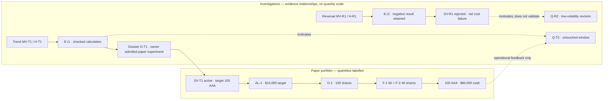

# One workspace: investigations → paper consequences

Proposed Markdown/Mermaid mockup. All values below are invented **synthetic Historical Reconstruction** fixtures, not market claims, executed results or actual ARH records. Exact record labels E:r1/T:a1 are symbolic fixture references, not fabricated ledger sequences/hashes.

For the successive desk experience and decisions, read [W-2: two complete cycles](desk-walkthrough.md). W-1 below remains the small original fixture with different quantities/zero execution fees; its records are not part of W-2's accounting. W-2 includes first-pass failures and repaired replays.

## Worked fixture W-1

Header: **Murmuration · CY-1 · Historical Reconstruction · M-1 proposed · as-of slot 1**

Research: 12.00 synthetic units authorized in the fixture; 3.00 settled (trend 1.00, reversal 1.00, evaluator 1.00), 0.00 pending; 9.00 remains (shared Research pool 8.00; Checker pool 1.00). This is a research-unit display, never dollars or portfolio capacity.

| Investigated | Fixed expectation and validation | Result / disposition | Next question |
|---|---|---|---|
| H-T1 / MV-T1: positive-return persistence | Gross toy trade +$30 on $1,000; base round-trip cost $10, stress $20; net >0; drawdown ≤2%; valid predeclared partition | Net +$20 base, +$10 stress; 1% drawdown; arithmetic checked; SV-T1 paper-exploratory dossier accepted by fixture owner | Q-T2: does the result survive a different volatility window? New untouched partition required |
| H-R1 / MV-R1: negative-return reversal | Same costs/criteria; gross +$5 on $1,000 | Net −$5 base, −$15 stress; candidate SV-R1 rejected; research hypothesis registration can still exist | Q-R2: is reversal confined to low-volatility events? Retains H-R1, failed results and sample reuse |

These scalar inputs are deliberately sufficient to check the toy arithmetic and acceptance predicate on paper, not to validate a strategy engine. Dossiers also cite timing, partition and reproducibility fixture attestations; removing any of those makes S-03 refuse. Source-data authenticity and statistically useful samples remain implementation/research work.

Paper event: portfolio initially $100,000 cash; price AAA=$100; SV-T1 requests 100 shares, $10,000. Fees zero in this execution fixture (research validation costs above are a separate backtest model). AL-1 admits 100 shares: 10% gross, 10% underlying, 10% strategy, 10% turnover. O-1 fills 60 then 40 at $100, resulting in 100 AAA, $90,000 cash, $100,000 marked NAV. Target was 100 throughout; actual position progressed 0→60→100. “Changed” shows +100 shares and −$10,000 cash from fills, not an inferred flow from research expense.

Primary view has these two bands and a narrow **Needs owner** area: pending Theme selection Q-R2, with failed predecessor one click away. Inspect reveals full dossiers, source refs, rejected alternatives and failure reasons; chatter, prompts, worker logs and infrastructure live there, not in the primary flow.

Visual grammar: all Mermaid edges equal width and mean labelled dependency/reference, never conserved money or causation. Solid edge = input/decision/execution relationship as labelled; dashed = recorded motivation only. A future quantity bar could show dollars within the portfolio band only, but this first mockup uses numeric labels and no proportional widths. Green plus text “active” means eligible and allocated, amber “pending/interrupted”, red “refused/rejected”, grey “stale/unavailable/retired”; colors never encode return or confidence. Status text and icons must carry meaning without color. A profitable result is not automatically green admission.

## C-09 — displayed facts and provenance

| Displayed fact | Source owner / public evidence | Freshness and missing behavior |
|---|---|---|
| Mandate, limits, cycle and next slot | Murmur owner/cycle records, exact version/revision | Missing mandate: unavailable, disable mutations |
| Question, method, lineage | Murmur method version plus exact ARH design/hypothesis/selection refs via `get/history` | Display pinned historic content; do not substitute latest method |
| Attempt, cost, pending maximum, remaining per-grant funds | ARH `budget`, `obligations`, exact attempt/settlement refs | Show ARH E/N/time; no local budget arithmetic used for authorization |
| Arithmetic status / applied registration | ARH CHECK / APPLIED via public `review/history/get` | “Decided, not applied” stays pending; no acceptance inferred from success response |
| Scientific/evidence sufficiency and strategy lifecycle | Murmur dossier/strategy events pinned to standard and ARH references | Separate labels: checked, insufficient evidence, paper-exploratory |
| Requested and admitted allocation / reason | Murmur AL records and limit checks | Target/as-of separate from current holdings |
| Ordinary / required-exit / total turnover; exit cost envelope | Murmur order/fill and exact C-05 exit-obligation records | Show used and outstanding amounts, cost consumed/reserved/remaining, and residual breaches; restart never resets allowance |
| Holdings, cash, NAV, returns, fees | Murmur accepted fills/cash events and exact marks; derived formulas | Marks missing/stale: quantity retained, valuation unavailable/stale; never show zero |
| Confirmed cash versus cash after commitments | Same book plus live/uncertain order commitments and bounded fees; owner-composed projection | Show confirmed, reserved and worst-case post-commitment values separately; unknown response never means free cash |
| What changed / feedback | Event diff over named prior and current revisions; selection references | No inferred causal claim; gaps show “history incomplete” |
| Needs owner / command eligibility | Relevant owner’s current precondition evaluation | Pending request is not authorization; revalidate at commit |

Each panel shows run identity, relevant source revision and observed-at time. Projection refresh target is 30 seconds for the proposed local slice; any source older than that or reporting mismatch is labelled stale. Historical panels show historical as-of rather than pretending live freshness. No cross-system snapshot exists: header shows the revision vector (Murmur portfolio revision; ARH E/N) and unresolved reconciliation. Mutations cannot rely on this vector alone.

## C-10 — user actions

Every mutation supplies durable command ID, exact subject, expected revision, actor and reason; response includes committed record refs or explicit refusal. All commands recheck current authority at the owner boundary. A lost response displays pending/uncertain and resolves by key. Refresh/inspect/retry are not approval.

| Action | Actor / authority and preconditions | Result / refusal |
|---|---|---|
| Inspect / refresh | Reader; exact reference available | No domain mutation. Missing/hash mismatch → unavailable with preserved label |
| Propose question/revision | Researcher under active scoped grant, accepted method, funding available | ARH design/research/proposal records, ancestry; invalid scope/budget → ARH refusal; unsupported → stop |
| Check | Separate evaluator, own active budget, exact current proposal | ARH CHECK; own lineage/insufficient funding/stale base refuses |
| Accept/reject research proposal | Owner or narrowly applicable upstream P-1; required current check | Keyed ARH decision then separate apply. UI shows decided until applied; stale/fenced apply refuses |
| Admit paper strategy | Owner under M-1, ES-M1 dossier complete, exact checked research refs | Murmur eligible event, no order. Missing independent evidence/timing → refusal |
| Rebalance | Delegated allocator; current strategy/mandate/portfolio closure | AL batch and keyed paper orders; stale base, overlap limits or unknown orders → refuse |
| Suspend / retire | Owner (or mandate's deterministic stop for suspension); exact strategy revision | Suspended/retiring event and exit obligation; flat terminal only after confirmed reconciliation |
| Resume | Owner, new complete dossier, no unresolved orders | Eligible event; stale dossier or retired version refuses; retired needs successor |
| Change mandate / budget / fence | Owner only; prospective version and explicit ARH control path | Murmur mandate and separately ARH control records; partial completion displays blocked reconciliation |
| Resolve interrupted work | Authorized operator; durable intent, ARH outcome/obligations and quiescence prerequisites | Resume same keys or explicit replacement; unknown completion never permits blind retry |

Pending: intent durable, no final answer. Interrupted: worker stopped or claim uncertain; liability shown. Stale: known older projection, no mutation authority. Unavailable: authority cannot be reached, retain last-known labelled values and stop dependent actions. A domain refusal cites its owner's reason; transport failure is not falsely recorded as an ARH domain refusal.

Every blocked card also names the unmet fact, the role that can resolve it, the next lawful action and what remains stopped. Missing provenance offers retrieval of the exact precommitted manifest, not a criterion waiver. Unknown order status offers lookup by the original ID, not a fresh order. Missing quiescence offers operator proof retrieval, not owner permission to bypass it. Distinguish a settled UNKNOWN charge from unresolved execution status. A refusal can be correct while the product workflow remains incomplete; show that openly.

For the current unattended proposal, [W-3](away-replay.md) shows routine activity versus owner exceptions and the return summary. Primary owner queue contains only mandate/judgment changes or unresolved operational prerequisites, with current state, risk and lawful options. Policy decisions list decider/policy version and exact independent check in inspection. The screen must distinguish DA-1 target behavior from current ARH's pending Theme gate. Display research grant closure/expiry separately from reservation release, and show independent opening-authority expiry, holding deadline and exit-only authority; a completed research badge never implies a flat portfolio.

Frozen B-01 correction: ordinary in-scope follow-ups display “next experiment under [exact existing Theme]” with design/history refs and no Theme-approval task. Genuine scope change shows the exact boundary being exceeded and owner options. Unknown original Theme/grant content produces a scope-evidence exception, never an inferred approval. The earlier W-3 Theme-gate card describes its explicit proposal choice, not every follow-up.
